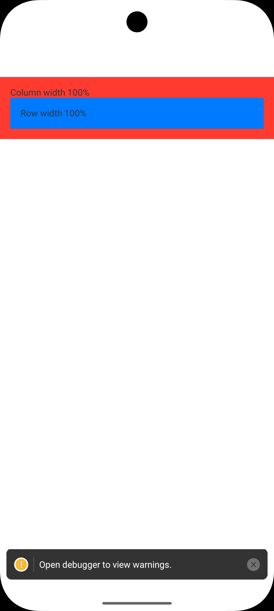
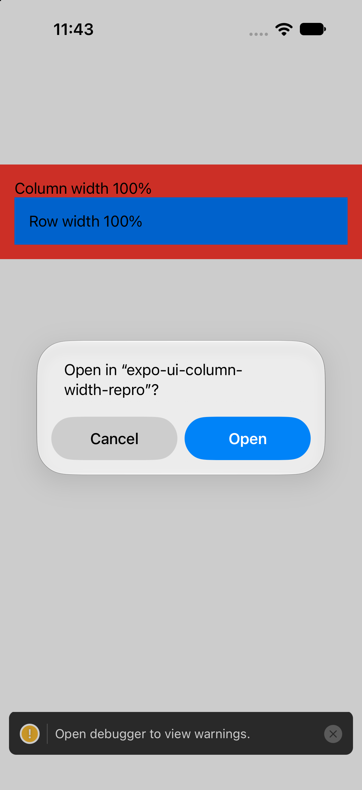

# expo-ui-column-width-repro

Minimal reproduction for: [benjaminkomen/solar-array-simulator#79](https://github.com/benjaminkomen/solar-array-simulator/issues/79)

## Bug

`@expo/ui` Compose `Column` (and other Host views) crash on Android with `FieldCastException` when given `style={{ width: "100%" }}`. The TypeScript types accept a string, but the native Android bridge expects an `Int`.

## Reproduce

1. `npm install`
2. `expo run:android`
3. Launch the app on an Android emulator
4. App crashes immediately with `FieldCastException`

## Expected

`width: "100%"` should either work (converted to `fillMaxWidth()`) or be rejected at compile time.

## Workaround

Replace `style={{ width: '100%' }}` with `style={{ width: Dimensions.get('window').width }}`.

## Recording

## Environment

- Expo SDK 57
- @expo/ui ~57.0.0
- React Native 0.86.3

## Fixed in SDK 58

Kudo fixed the `FieldCastException` crash with string widths on `Column`/`Row`. The fix is the stack that ends in [expo/expo#51120](https://github.com/expo/expo/pull/51120): #51117 (types), #51118 (Android), #51119 (iOS), #51120. It adds percentage sizes to universal `Column` and `Row`. It shipped in Expo SDK 58, in `@expo/ui` 58.0.23 and later. My PR [expo/expo#50094](https://github.com/expo/expo/pull/50094) was closed in favour of this fix.

Verified on `@expo/ui` 58.0.24 (Expo 58.0.20, React Native 0.88.0). `style={{ width: '100%' }}` on `Column` and `Row` no longer crashes, and both fill the screen width on the Android emulator (Pixel 10 Pro) and the iOS Simulator (iPhone 18 Pro). The red block is the `Column` and the blue block is the `Row`. On iOS, a leftover system "Open in…" dialog covers the lower half of the screenshot.

| Android | iOS |
| --- | --- |
|  |  |
